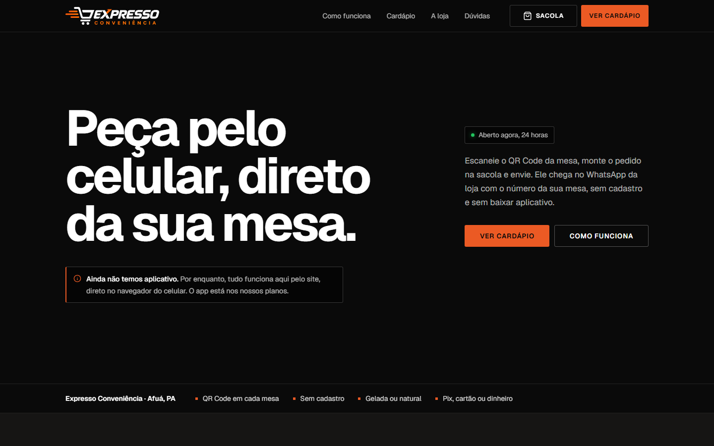
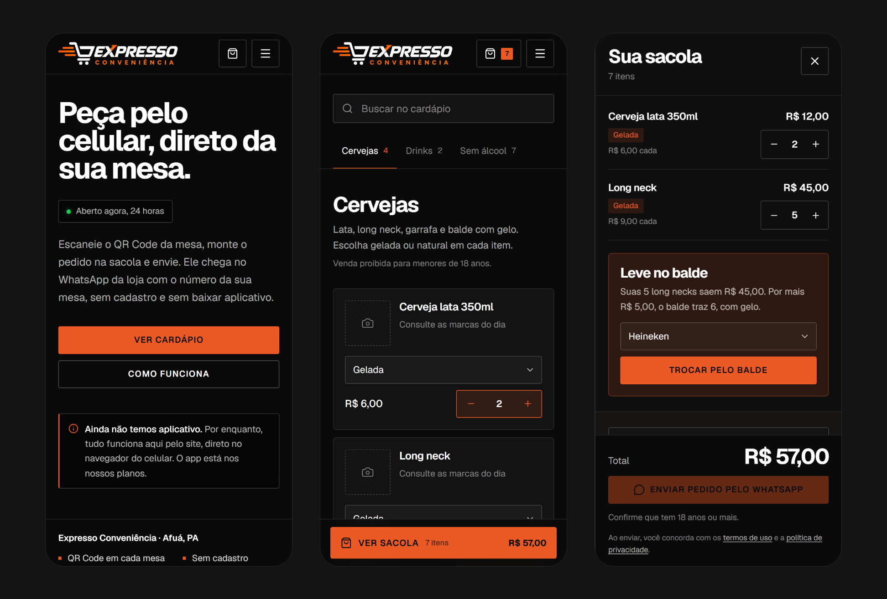
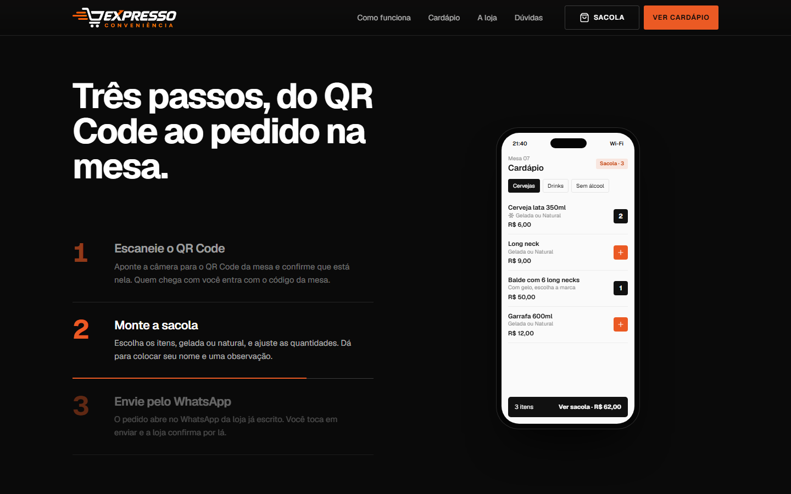

# Expresso Conveniência: cardápio digital com pedido pela mesa

Site em React para uma loja de conveniência em Afuá (PA). O cliente escaneia o **QR Code da mesa**, monta a sacola no celular e o pedido chega **pronto no WhatsApp da loja**, com o número e o código da mesa. Não tem cadastro, não tem aplicativo para baixar e não tem pagamento online: paga-se no balcão.



**Stack:** React 19 · Vite 8 · CSS puro (sem framework de UI) · lucide-react (ícones) · Supabase (Postgres + Auth, chamado com `fetch`, sem SDK) · qrcode-generator · PGlite nos testes do banco · oxlint · Vercel · GitHub Actions + Dependabot

```bash
npm install
npm run dev
```

Sem nenhuma configuração, o site já funciona: a mesa vem do número no QR Code. Para ligar a **trava de mesa** e o **painel da loja**, siga os passos no começo de [`supabase/mesas.sql`](supabase/mesas.sql) e copie `.env.example` para `.env.local`.

```bash
npm run test:sql     # 21 testes do banco, 14 deles de ataque
npm run seguranca    # npm audit + lint + testes do banco (o mesmo que o pipeline roda)
```

---

## O que o site faz



- **Pedido pelo WhatsApp, sem backend de pedidos.** A sacola vira um texto formatado (`*negrito*` do WhatsApp, item por item, total, mesa e código) e abre num link `wa.me` já escrito. O cliente só toca em enviar. A loja recebe o pedido no app que já usa, sem nenhum sistema novo para aprender.
- **Cardápio com busca que ignora acento.** "agua" acha "Água" e "maracuja" acha o suco e a caipirinha, porque a busca também passa pelas opções de cada item. A barra de categorias acompanha a rolagem e marca a seção que está na tela.
- **Opções em cada item.** Gelada ou natural, sabor, marca. Cada combinação de item + opção vira uma linha separada na sacola, e o seletor mostra quantas unidades de cada opção já foram escolhidas.
- **"Leve no balde".** Com 5 ou mais long necks avulsas na sacola, aparece a conta do balde com os preços do cardápio ("Suas 5 long necks saem R$ 45,00. Por mais R$ 5,00, o balde traz 6, com gelo") e um botão que faz a troca na hora. Se o balde não compensar, a sugestão não aparece.
- **"Mais uma rodada?".** Depois de enviar, o último pedido fica guardado no aparelho por 12 horas, e um cartão no cardápio repete o pedido com um toque. Os preços são os do cardápio de agora, não os do pedido antigo.
- **Bebida alcoólica só com confirmação de 18 anos.** A categoria marcada com `alcool: true` exige a caixa de confirmação antes do envio. A confirmação não é salva nem enviada.
- **Horário de funcionamento no fuso do Pará.** "Aberto agora, fecha à meia-noite" é calculado com `Intl.DateTimeFormat` em `America/Belem`, independente do fuso do celular. Funciona com horário que passa da meia-noite e com dias 24 horas emendados.
- **Chamar atendente.** Com a mesa conhecida, um botão no cardápio abre o WhatsApp com "Mesa 7: pode vir até a mesa, por favor?".
- **Demonstração animada.** Na seção "Três passos", um celular desenhado em HTML mostra o pedido acontecendo: lê o QR, monta a sacola, envia pelo WhatsApp. Os itens e preços da animação vêm do cardápio real, então nunca ficam desatualizados. A animação só roda enquanto está na tela e fica parada com `prefers-reduced-motion`.
- **Política de privacidade e termos de uso.** Escritos para o que o site realmente faz (LGPD, ECA, CDC, Marco Civil), montados a partir dos dados da loja em `site.js`.



### Sistema de mesas (opcional, com Supabase)

- **Confirmação de mesa.** O primeiro celular que escaneia o QR ocupa a mesa e recebe um **código de 4 números**. Quem chega depois na mesma mesa só entra no grupo digitando esse código, e cada celular pede pelo próprio aparelho.
- **Painel da loja em `/painel`.** Mostra as mesas ocupadas (atualiza a cada 20s), libera uma mesa com dois toques, lista os alertas de segurança das últimas 24 horas e gera o QR Code de cada mesa, pronto para imprimir em SVG.
- **Login da equipe com senha + app autenticador (TOTP).** O primeiro login obriga a cadastrar o autenticador. O banco recusa qualquer chamada do painel sem as duas etapas.
- **Liberação automática.** A mesa fica livre sozinha depois de 3 horas sem pedido.

---

## Decisões técnicas

### 1. A chave da mesa vai depois do `#`
```
https://dominio/cardapio?mesa=7#k=3f9a…c21e
```
Cada mesa tem uma chave secreta aleatória (122 bits, do `gen_random_uuid`) que só existe no QR Code impresso. Sem ela, ninguém ocupa a mesa. Isso fechou o achado mais grave do teste de invasão: um anônimo, de casa, ocupava as 59 mesas de teste em segundos. A chave vai no fragmento (`#`) porque o navegador nunca envia essa parte ao servidor: ela não aparece em log de acesso nem em `Referer`. Ao abrir o site, o `MesaProvider` tira a mesa e a chave do endereço com `history.replaceState`, para não ficarem no histórico nem irem junto se a pessoa compartilhar o link.

### 2. O banco guarda só hashes
Chaves dos QR Codes e tokens dos celulares ficam no Postgres apenas como SHA-256. Um backup vazado não permite ocupar mesas nem se passar por um cliente. Por isso o QR só pode ser visto na hora em que é gerado: o painel avisa para baixar ou imprimir antes de fechar, e "Gerar novo" invalida o antigo na hora.

O código de 4 números é a exceção, de propósito: fica em texto porque a equipe precisa vê-lo no painel para conferir os pedidos. Ele só vale junto com a chave da mesa e trava depois de 8 erros.

### 3. O site nunca toca nas tabelas
```sql
alter table public.mesas enable row level security;
revoke all on public.mesas, public.ocupacoes, ... from public, anon, authenticated;
```
Todas as tabelas têm RLS ligado e nenhuma permissão para visitantes. O site só chama funções (`ocupar_mesa`, `entrar_mesa`, `conferir_mesa`, `registrar_pedido`, mais 5 do painel), que conferem o formato de cada parâmetro. Elas rodam como um papel próprio, `mesas_sistema`, que não é superusuário, não ignora o RLS e não lê a tabela da equipe. Todas têm `search_path = ''` e usam nomes completos, então ninguém troca uma tabela por outra de mesmo nome.

### 4. Os ataques viraram testes
```js
test('500 chaves aleatórias não ocupam nenhuma mesa', ...)
```
O [`supabase/testes/banco.mjs`](supabase/testes/banco.mjs) sobe um Postgres local com **PGlite** (Postgres em WebAssembly, sem Docker e sem internet), imitando o que importa do Supabase: os papéis `anon` e `authenticated`, as permissões padrão e o token de login. O mesmo `mesas.sql` que vai para produção roda ali. Para conferir que os testes pegam falhas de verdade, plantei 3 falhas no SQL de propósito (visitante lendo a tabela, painel sem o autenticador e chave do QR ignorada). Os testes pegaram as 3.

### 5. Supabase sem SDK
```js
fetch(`${URL_SUPABASE}/rest/v1/rpc/${funcao}`, { method: 'POST', headers, body, keepalive })
```
O site só chama algumas funções e meia dúzia de rotas de login, então `lib/servidor.js` faz tudo com `fetch` em menos de 100 linhas, sem a biblioteca do Supabase no bundle. Ele se recusa a ligar o sistema de mesas se a URL não for `https://`. O `registrar_pedido` usa `keepalive: true`, porque o WhatsApp abre logo em seguida e a página pode ser suspensa antes da resposta chegar.

### 6. Rotas sem biblioteca
```js
export const caminho = window.location.pathname.replace(/\/+$/, '') || '/'
export const naPaginaDoCardapio = caminho === '/cardapio'
```
São quatro telas (início, cardápio, páginas legais e painel), então não instalei o React Router. O `App` escolhe a página pelo caminho e o `vercel.json` manda qualquer caminho para o `index.html`. O painel é uma tela à parte, sem cabeçalho, sacola nem rodapé, e não aparece em nenhum link do site.

### 7. A sacola é um reducer, e o que vem do aparelho é conferido
```js
case 'juntar': // "Pedir de novo": soma no que já estiver na sacola
```
O `useReducer` da sacola tem as ações `adicionar`, `quantidade`, `juntar`, `remover` e `limpar`, e fica num Context para o cardápio, a barra fixa e a sacola compartilharem o mesmo estado. Ao ler o `localStorage`, cada linha é validada contra o cardápio atual: item que saiu do cardápio ou opção que mudou é descartado. O preço nunca é salvo, porque vale sempre o do cardápio. O mesmo cuidado vale para a mesa confirmada e o login do painel: só é aceito o formato exato que o servidor devolve.

### 8. Todo o conteúdo da loja num arquivo só
`src/data/site.js` tem nome, endereço, WhatsApp, horários por dia da semana, fotos e o cardápio inteiro. Os componentes, a demonstração animada, o QR impresso e até os textos legais leem dali. Trocar um preço ou o horário é editar uma linha, sem mexer em JSX. Um campo `null` esconde o que depende dele (sem WhatsApp, os botões somem; sem foto, aparece um espaço reservado com a descrição do que deve entrar ali).

### 9. Cabeçalhos de segurança na hospedagem
O `vercel.json` aplica CSP sem `unsafe-inline` (scripts só do próprio domínio), HSTS de 2 anos, `X-Frame-Options: DENY` contra clickjacking e `Permissions-Policy` negando câmera, microfone, localização e pagamento. O `/painel` ainda recebe `noindex` e `no-store`.

### 10. QR Code carregado só quando a loja precisa
```js
const { default: qrcode } = await import('qrcode-generator')
```
A biblioteca de QR Code só é baixada no painel, quando a loja gera um cartão. O cliente nunca baixa esses 20 kB. O cartão em SVG leva o domínio escrito embaixo do QR, para o cliente conferir o endereço e perceber um adesivo falso colado por cima.

---

## Como o projeto evoluiu

- **Começou como cardápio + sacola + WhatsApp**, com a mesa vindo só do número no QR Code. Esse modo continua funcionando sem nenhuma configuração.
- **A trava de mesa entrou para a loja não confundir as mesas.** O primeiro desenho tinha um problema: qualquer um que soubesse o endereço podia ocupar mesas de casa.
- **O teste de invasão foi feito em duas fases.** Na primeira, ataquei o sistema como estava, num Postgres local. Entre os achados:
  - mesas ocupadas em massa de fora da loja;
  - mesa de outro grupo travada de longe, errando o código 8 vezes;
  - token guardado em texto puro;
  - painel protegido só por senha;
  - código gerado com `random()`;
  - chave da mesa no endereço normal, aparecendo nos logs.
- **Na segunda fase, depois das correções, repeti os ataques de ponta a ponta.** Veio a chave por mesa depois do `#`, os hashes, o papel `mesas_sistema`, o TOTP obrigatório e `gen_random_uuid`. Os ataques do banco viraram os testes automáticos de `npm run test:sql`. O relatório completo, com os 20 itens verificados, está em [`SEGURANCA.md`](SEGURANCA.md).
- **O pipeline fecha o ciclo.** O GitHub Actions roda `npm ci`, `npm audit`, lint, os ataques ao banco e o build a cada push e toda segunda-feira, e o Dependabot abre pedidos de atualização quando sai correção.

---

## Estrutura

```
src/
├── App.jsx                 # escolhe a página pelo caminho e monta os providers
├── data/
│   ├── site.js             # dados da loja, horários, fotos e cardápio
│   └── legal.js            # política de privacidade e termos, montados a partir de site.js
├── lib/
│   ├── carrinho.js         # reducer da sacola, validação do que vem do localStorage, último pedido
│   ├── pedido.js           # mesa e chave do QR, texto do pedido para o WhatsApp
│   ├── horario.js          # aberto/fechado no fuso do Pará
│   ├── servidor.js         # fetch para as funções e o login do Supabase
│   ├── mesa.js / painel.js # sessão da mesa e login da equipe salvos no aparelho
│   ├── qr.js               # cartão do QR Code em SVG
│   └── rota.js / formato.js
└── Components/
    ├── landing/            # topo, vitrine, três passos, benefícios, onde estamos, dúvidas, rodapé
    ├── cardapio/           # página do cardápio com busca e "Mais uma rodada?"
    ├── sacola/             # sacola, barra fixa, botões de adicionar, seletor de opções
    ├── mesa/               # janela de confirmação da mesa
    ├── painel/             # login com TOTP, mesas ocupadas, alertas, QR Codes
    ├── Celular.jsx         # demonstração animada do pedido
    ├── CarrinhoProvider.jsx / MesaProvider.jsx
    └── Revelar.jsx / Foto.jsx / Mini.jsx / Logo.jsx / PaginaLegal.jsx
supabase/
├── mesas.sql               # tabelas, RLS, papel mesas_sistema e funções (com o passo a passo de instalação)
└── testes/                 # Postgres local com PGlite e os 21 testes de funcionamento e ataque
.github/                    # pipeline de segurança e Dependabot
vercel.json                 # rotas e cabeçalhos de segurança
SEGURANCA.md                # relatório do teste de invasão e checklist antes de publicar
```

---

## Próximos passos

- [ ] Trocar os dados de exemplo pelos reais em `site.js`: endereço, WhatsApp, preços e fotos próprias da loja
- [ ] Registrar o domínio e publicar na Vercel, seguindo o checklist de [`SEGURANCA.md`](SEGURANCA.md)
- [ ] Servir as fontes do próprio domínio, para o navegador do cliente não precisar falar com o Google
- [ ] Cobrir o reducer da sacola e o cálculo de horário com testes (Vitest), incluindo horário que passa da meia-noite
- [ ] Fixar as ações do GitHub pelo hash do commit em vez de `@v4`
- [ ] Revisão da política de privacidade e dos termos por um advogado
